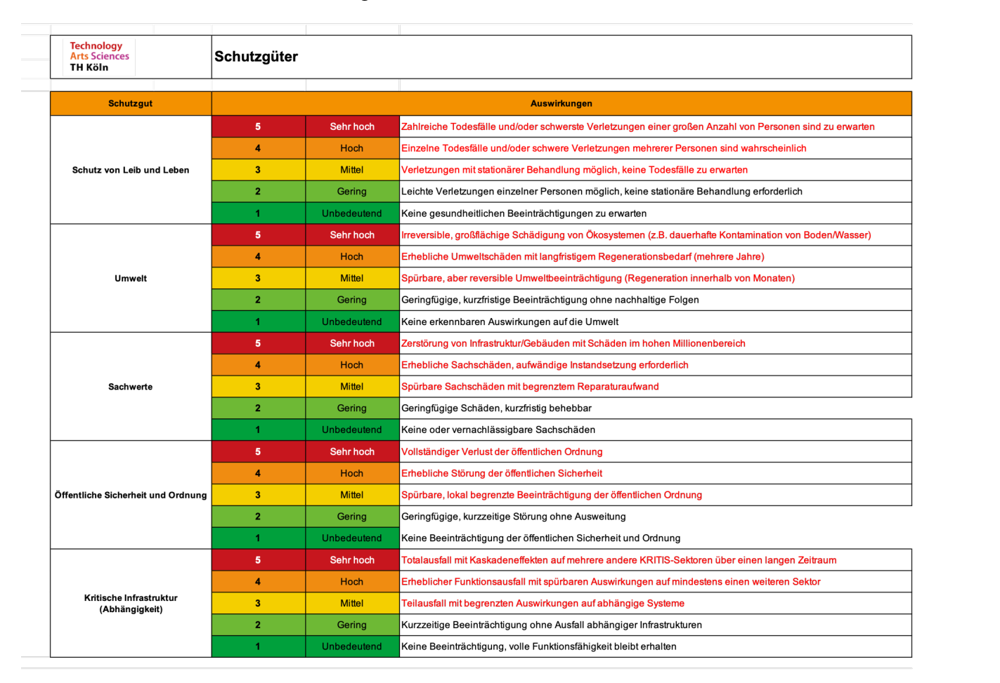

# Zeitkritikalität kommunaler KRITIS

**Eine Business Impact Analyse nach BSI-Standard 200-4, umgebaut für den Bevölkerungsschutz.**

Wenn Strom, Wasser oder Kommunikation in einer Kommune ausfallen, oder wenn Anlagen geräumt werden müssen: Welche Infrastruktur braucht zuerst Aufmerksamkeit? Dieses Verfahren beantwortet das, ohne nach Eintrittswahrscheinlichkeiten zu fragen. Es fragt nur, **wie lange ein Ausfall tragbar ist, bevor der Schaden für die Bevölkerung untragbar wird.**

## Die Idee

Die Business Impact Analyse (BIA) aus dem BSI-Standard 200-4 findet in Unternehmen die zeitkritischen Prozesse. Ihr Maßstab ist der Fortbestand des Unternehmens: Geld, Recht, Ruf.

Für den Bevölkerungsschutz bleibt die Mechanik gleich, nur der Maßstab ändert sich:

| | Klassische BIA | Diese Variante |
|---|---|---|
| Betrachtet | Geschäftsprozesse eines Unternehmens | Sektoren, Branchen und Dienstleistungen einer Kommune |
| Schutzgut | Fortbestand des Unternehmens | Versorgung und Sicherheit der Bevölkerung |
| Schadenskategorien | Finanzen, Recht, Reputation | Leib und Leben, Umwelt, Sachwerte, öffentliche Sicherheit und Ordnung, abhängige KRITIS |
| Ergebnis | Maximal tolerierbare Ausfallzeit je Prozess | Maximal tolerierbare Ausfallzeit (MTPD) je Branche bzw. Dienstleistung, daraus eine Reihenfolge |

**Warum nicht die klassische Risikoanalyse?** Für komplexe KRITIS-Ausfälle gibt es keine belastbaren Eintrittswahrscheinlichkeiten. Seltene, schwere Ereignisse würden dadurch kleingerechnet. **Warum nicht FMEA?** Sie braucht Kenntnisse über jede technische Komponente und vergleicht keine Branchen untereinander. **Warum nicht nur GIS?** Räumliche Nähe heißt noch nicht funktionale Abhängigkeit.

## Zwei Ebenen: Kommune und Betreiber

> **Wichtig:** Die Schritte 1 bis 6 bewerten auf Ebene der **Kommune**: Sektoren, Branchen und Dienstleistungen, etwa „Stromverteilung im Stadtgebiet“. **Einzelne Anlagen**, etwa ein bestimmtes Umspannwerk, kommen darin nicht vor. Sie liegen beim **Betreiber**, also auf Unternehmensebene.

Die beiden Ebenen fragen Verschiedenes:

| | Kommune (Schritte 1–6) | Betreiber (Schritt 7) |
|---|---|---|
| Gegenstand | Branche bzw. Dienstleistung | konkrete Anlage |
| Frage | Wie lange erträgt die **Bevölkerung** den Ausfall? | Kann die **Anlage** diese Vorgabe einhalten? |
| Grundlage | diese angepasste BIA | Redundanz, Notstrom, Wiederanlauf, eigene BIA des Betreibers |
| Ergebnis | MTPD je Dienstleistung, Reihenfolge | erfüllt ja/nein, Maßnahmen |

**Schritt 7 verbindet die Ebenen:** Die tolerierbare Ausfallzeit, die die Kommune für eine Dienstleistung festlegt, wird zur **Anforderung an jede Anlage**, die diese Dienstleistung erbringt. Ein Beispiel: Die Stromverteilung verträgt höchstens 12 Stunden Ausfall. Also muss jedes Umspannwerk spätestens nach 12 Stunden wieder liefern oder durch Redundanz ersetzt werden.

## Schritt für Schritt mit der Excel

Das Werkzeug: [`werkzeug/bia_zeitkritikalitaet.xlsx`](werkzeug/bia_zeitkritikalitaet.xlsx). Es hat ein Blatt je Schritt. Die Startseite erklärt den Ablauf und verlinkt die Blätter. **Gelbe Felder** sind Eingaben, **graue Felder** werden berechnet. Die Datei läuft ab Excel 2010 und braucht keine Makros.

### Schritt 1: Schutzgüter festlegen · Blatt *1 Schutzgüter*

Welche Folgen eines Ausfalls zählen? Vorgeschlagen sind fünf Schutzgüter, angelehnt an das Kriterium „Qualität“ der BBK-Methode zur Identifizierung kritischer Infrastrukturen:

1. Schutz von Leib und Leben
2. Umwelt
3. Sachwerte
4. Öffentliche Sicherheit und Ordnung
5. Kritische Infrastruktur (Abhängigkeit): Wie stark reißt der Ausfall andere Sektoren mit?

Die Namen lassen sich ändern und werden dann in alle Blätter übernommen.

### Schritt 2: Schadensklassen beschreiben · Blatt *2 Schadensklassen*

Jedes Schutzgut bekommt fünf Stufen von 1 (unbedeutend) bis 5 (sehr hoch), jeweils mit einer konkreten Beschreibung. So bewerten verschiedene Personen nach demselben Maßstab.

### Schritt 3: Untragbarkeitsniveau festlegen · Blatt *3 Untragbarkeit*

Ab welcher Schadensklasse ist ein Zustand für die Kommune nicht mehr hinnehmbar? Vorgeschlagen ist **Klasse 3**. Das Blatt zeigt sofort, was die gewählte Klasse für jedes Schutzgut bedeutet, etwa für Leib und Leben: „Verletzungen mit stationärer Behandlung möglich“.

### Schritt 4: Zeitfenster festlegen · Blatt *4 Zeitfenster*

| Zeitfenster | Obergrenze | Bedeutung |
|---|---|---|
| unter 30 Min. | 0,5 h | schon kurze Unterbrechungen schaden erheblich |
| unter 12 Std. | 12 h | Wiederherstellung innerhalb eines Einsatz- oder Tageszyklus nötig |
| unter 24 Std. | 24 h | |
| unter 72 Std. | 72 h | |
| unter 7 Tagen | 168 h | |

Die Obergrenze in Stunden wird in Schritt 7 für den Abgleich mit den Anlagen gebraucht.

### Schritt 5: Branchen und Dienstleistungen bewerten · Blatt *5 Bewertung*

Für jede Zeile und jedes Schutzgut wird gefragt: *Welche Schadensklasse ist erreicht, wenn die Dienstleistung so lange ausfällt?* Das sind 5 Schutzgüter × 5 Zeitfenster, also 25 Werte je Zeile. Die Werte steigen meist mit der Zeit. Die Felder lassen nur 1 bis 5 zu und färben sich von Grün nach Rot. Daneben gehört eine kurze Begründung, damit die Bewertung nachvollziehbar bleibt.

Die Liste der Sektoren, Branchen und Dienstleistungen ist vorbereitet und kann ergänzt werden. Als Ebene sind nur Sektor, Branche und Dienstleistung wählbar. **Anlagen gehören in Schritt 7.**

### Schritt 6: Ergebnis ablesen · Spalte MTPD und Blatt *6 Ergebnis*

Die MTPD wird nach dem **Prinzip der strengsten Restriktion** berechnet: Das erste Zeitfenster, in dem *irgendein* Schutzgut das Untragbarkeitsniveau erreicht, ist die tolerierbare Ausfallzeit der ganzen Zeile. Bleiben alle Werte darunter, steht dort „keine MTPD“. Fehlen Werte, steht dort „unvollständig“.

Das Blatt *6 Ergebnis* zählt, wie viele Dienstleistungen in jedes Zeitfenster fallen, und erstellt automatisch die **Rangfolge**, mit den zeitkritischsten oben.

### Schritt 7: Von der Dienstleistung zur Anlage · Blatt *7 Anlagen*

Für die Dienstleistungen oben in der Rangfolge werden die konkreten Anlagen geprüft, gemeinsam mit Betreibern und der unteren Katastrophenschutzbehörde. Je Anlage wird eingetragen:

- welche Dienstleistung sie erbringt und welche **Vorgabe** (MTPD) daraus folgt
- **Anlage, Betreiber, Standort**
- **nach wie vielen Stunden die Dienstleistung wieder verfügbar ist**, wenn die Anlage ausfällt (0, wenn eine Redundanz sofort übernimmt)

Das Blatt vergleicht das mit der Vorgabe und zeigt **erfüllt: ja/nein**. Wo „nein“ steht, gehören Redundanzen, Notstrom, Abhängigkeiten und Maßnahmen in die Spalten daneben. Beim Stromnetz sind das zum Beispiel Spannungsebenen, Umspannwerke, Trafostationen und alternative Einspeisungen.

## Beispiel: Energie und Wasser

Diese Bewertungen sind in der Excel bereits eingetragen:

| Rang | Branche bzw. Dienstleistung | MTPD | Begründung (gekürzt) |
|---|---|---|---|
| 1 | Strom: Übertragung/Verteilung | **< 12 h** | BOS-Kommunikation, medizinische Heimgeräte und Intensivstationen müssen bis dahin autark versorgt sein |
| 1 | Öffentliche Wasserversorgung | **< 12 h** | |
| 2 | Strom: Erzeugung | < 24 h | kurzfristig über das Verbundnetz ausgleichbar, danach sinkt die Netzstabilität |
| 2 | Kanalisation | < 24 h | |
| 3 | Gas | < 72 h | der Leitungsdruck puffert, danach fällt die Wärmeversorgung aus |
| 3 | Fernwärme | < 72 h | die Gebäude kühlen langsam aus, kritisch vor allem in Pflegeeinrichtungen |
| 3 | Kläranlagen | < 72 h | |
| 4 | Mineralöl | < 7 Tage | große dezentrale Vorräte |

In Schritt 7 ist als Beispiel „Übertragung/Verteilung → Umspannwerk → Netzbetreiber“ angelegt.

## Grenzen

- Die Schritte 1 bis 6 ersetzen keine Analyse einzelner Anlagen. Dafür gibt es Schritt 7, und dafür braucht es die Betreiber.
- Einheitliche Zeitschwellen und die strengste Restriktion sind bewusst konservativ. Manche Bereiche werden dadurch eher zu hoch eingestuft.
- Redundanzen und lokale Netzstrukturen wirken erst in Schritt 7. In der Rangfolge der Schritte 1 bis 6 sind sie nicht enthalten.
- Die Bewertungen sind Einschätzungen. Am besten bewerten mehrere Personen unabhängig voneinander und gleichen die Ergebnisse ab.

## Herkunft

Entstanden in der Hausarbeit „Zeitkritikalität bei der Evakuierung kritischer Anlagen“ im Modul Kritische Infrastrukturen und Bevölkerungsschutz (Prof. Dr. Alexander Fekete), Institut für Rettungsingenieurwesen und Gefahrenabwehr, TH Köln, 2026. Schutzgüter und Excel-Werkzeug sind gemeinsam mit Hendrik Platz entwickelt. Für dieses Repo wurde die Excel neu aufgebaut, mit einem Blatt je Schritt, einer automatischen Rangfolge und dem Anlagenabgleich in Schritt 7. Mehr zur Arbeit: [Steckbrief in RIW-Projekte](https://github.com/2708Tom/RIW-Projekte/tree/main/2026-07_KRITIS_Zeitkritikalitaet-Evakuierung).

Grundlagen: BSI-Standard 200-4 Business Continuity Management (2023); BBK: Schutz Kritischer Infrastrukturen – Identifizierung in sieben Schritten (2019).
