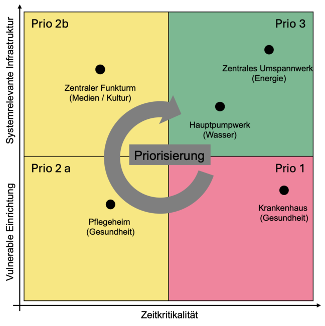

# Zeitkritikalität kommunaler KRITIS

**Eine Business Impact Analyse nach BSI-Standard 200-4, umgebaut für den Bevölkerungsschutz.**

Wenn in einer Kommune Strom, Wasser oder Kommunikation ausfallen: Welche Dienstleistung braucht zuerst Aufmerksamkeit? Das Verfahren fragt nicht nach Eintrittswahrscheinlichkeiten, sondern danach, wie lange ein Ausfall tragbar ist, bevor der Schaden für die Bevölkerung untragbar wird. Das Ergebnis ist eine maximal tolerierbare Ausfallzeit (MTPD) je Dienstleistung und daraus eine Reihenfolge.

## Die Idee

Die Business Impact Analyse (BIA) aus dem BSI-Standard 200-4 findet in Unternehmen die zeitkritischen Prozesse. Ihr Maßstab ist der Fortbestand des Unternehmens, also Geld, Recht und Ruf. Für den Bevölkerungsschutz bleibt die Mechanik gleich, nur der Maßstab ändert sich:

| | Klassische BIA | Diese Variante |
|---|---|---|
| Betrachtet | Geschäftsprozesse eines Unternehmens | Sektoren, Branchen und Dienstleistungen einer Kommune |
| Schutzgut | Fortbestand des Unternehmens | Versorgung und Sicherheit der Bevölkerung |
| Schadenskategorien | Finanzen, Recht, Reputation | Leib und Leben, Umwelt, Sachwerte, öffentliche Sicherheit und Ordnung, abhängige KRITIS |
| Ergebnis | maximal tolerierbare Ausfallzeit je Prozess | maximal tolerierbare Ausfallzeit je Dienstleistung, daraus eine Reihenfolge |

Warum nicht die klassische Risikoanalyse? Für komplexe KRITIS-Ausfälle gibt es keine belastbaren Eintrittswahrscheinlichkeiten, und seltene, schwere Ereignisse würden kleingerechnet. Warum nicht FMEA? Sie braucht Kenntnisse über jede technische Komponente und vergleicht keine Branchen untereinander. Warum nicht nur GIS? Räumliche Nähe heißt noch nicht funktionale Abhängigkeit.

## Was das Werkzeug abdeckt und was nicht

Bewertet werden Sektoren, Branchen und Dienstleistungen aus Sicht der Kommune, zum Beispiel „Stromverteilung im Stadtgebiet“. Am Ende steht für jede Dienstleistung eine MTPD. Mehr nicht.

Einzelne Anlagen, etwa ein bestimmtes Umspannwerk, sind Sache der Betreiber. Wie ein Betreiber seine Anlagen so aufstellt, dass die Dienstleistung innerhalb der MTPD wieder läuft, gehört nicht zu diesem Werkzeug. Die MTPD kann den Betreibern aber als Vorgabe dienen.

## Einordnung ins KRITIS-Dachgesetz

Das [KRITIS-Dachgesetz](https://www.gesetze-im-internet.de/kritisdachg/BJNR0420B0026.html) (KRITISDachG, in Kraft seit 17.03.2026) regelt die physische Resilienz kritischer Anlagen. Es trennt dieselben Ebenen: Eine kritische Dienstleistung ist die Versorgung der Allgemeinheit, deren Ausfall zu erheblichen Versorgungsengpässen oder Gefahren für die öffentliche Sicherheit führen würde (§ 2 Nr. 4). Eine kritische Anlage ist eine Anlage, die für die Erbringung einer kritischen Dienstleistung erheblich ist (§ 2 Nr. 3). Die Pflichten aus dem Gesetz, also Risikoanalyse (§ 12), Resilienzplan (§ 13) und gegebenenfalls ein branchenspezifischer Resilienzstandard (§ 14), treffen die Betreiber.

Das Gesetz erfasst nur große Anlagen. Als Regelwert gilt eine Anlage als kritisch, wenn sie 500.000 Einwohner versorgt (§ 5 Abs. 2). Die genauen Kategorien und Schwellenwerte legt eine Rechtsverordnung fest (§ 4 Abs. 3, § 5 Abs. 1). Die meisten Anlagen einer Kommune liegen darunter. Kommunen und untere Katastrophenschutzbehörden kommen im Gesetz nicht vor. Risikoanalysen führen Bund und Länder (§ 11, mindestens alle vier Jahre) sowie die Betreiber durch. Dieses Werkzeug schließt die Lücke auf kommunaler Ebene. Die Ergebnisse der staatlichen Risikoanalysen, die das BBK weitergibt (§ 11 Abs. 6), lassen sich in Schritt 5 als Grundlage nutzen.

Auch die Bewertung passt: Das Gesetz versteht unter Risikobewertung das Vergleichen und Priorisieren von Risiken (§ 2 Nr. 8). Genau das leistet Schritt 6. Beim Risikobegriff selbst rechnet das Gesetz mit Wahrscheinlichkeit (§ 2 Nr. 6). Darauf verzichtet dieses Verfahren bewusst.

*Stand November 2026. Die Rechtsverordnung nach § 4 Abs. 3 und § 5 Abs. 1 lag bei der Recherche nur als Entwurf vor. Als geeignet festgestellte Branchenstandards waren keine zu finden. Das ist eine fachliche Einordnung, keine Rechtsberatung.*

## Schritt für Schritt mit der Excel

[`werkzeug/bia_zeitkritikalitaet.xlsx`](werkzeug/bia_zeitkritikalitaet.xlsx) ist die leere Vorlage mit vorbereiteter Liste der Sektoren und Branchen. Ein ausgefülltes Beispiel liegt unter [`beispiel/beispiel_energie_wasser.xlsx`](beispiel/beispiel_energie_wasser.xlsx). Die Excel hat ein Blatt je Schritt, die Startseite erklärt den Ablauf. Gelbe Felder sind Eingaben, graue werden berechnet. Die Datei läuft ab Excel 2010 und braucht keine Makros.

### Schritt 1: Schutzgüter festlegen (Blatt *1 Schutzgüter*)

Welche Folgen eines Ausfalls zählen? Vorgeschlagen sind fünf Schutzgüter, angelehnt an das Kriterium „Qualität“ der BBK-Methode zur Identifizierung kritischer Infrastrukturen:

1. Schutz von Leib und Leben
2. Umwelt
3. Sachwerte
4. Öffentliche Sicherheit und Ordnung
5. Kritische Infrastruktur (Abhängigkeit): Wie stark reißt der Ausfall andere Sektoren mit?

Die Namen lassen sich ändern und werden in alle Blätter übernommen.

### Schritt 2: Schadensklassen beschreiben (Blatt *2 Schadensklassen*)

Jedes Schutzgut bekommt fünf Stufen von 1 (unbedeutend) bis 5 (sehr hoch), jeweils mit einer konkreten Beschreibung. So bewerten verschiedene Personen nach demselben Maßstab.

### Schritt 3: Untragbarkeitsniveau festlegen (Blatt *3 Untragbarkeit*)

Ab welcher Schadensklasse ist ein Zustand für die Kommune nicht mehr hinnehmbar? Vorgeschlagen ist Klasse 3. Das Blatt zeigt sofort, was die gewählte Klasse für jedes Schutzgut bedeutet, für Leib und Leben etwa „Verletzungen mit stationärer Behandlung möglich“.

### Schritt 4: Zeitfenster festlegen (Blatt *4 Zeitfenster*)

Vorgeschlagen sind fünf Zeitfenster: unter 30 Minuten, unter 12 Stunden, unter 24 Stunden, unter 72 Stunden und unter 7 Tagen. Unter 30 Minuten heißt, schon kurze Unterbrechungen schaden erheblich. Unter 12 Stunden heißt, die Dienstleistung muss innerhalb eines Einsatz- oder Tageszyklus wieder laufen.

### Schritt 5: Branchen und Dienstleistungen bewerten (Blatt *5 Bewertung*)

Für jede Zeile und jedes Schutzgut wird gefragt: Welche Schadensklasse ist erreicht, wenn die Dienstleistung so lange ausfällt? Das sind 5 Schutzgüter mal 5 Zeitfenster, also 25 Werte je Zeile. Die Werte steigen meist mit der Zeit. Die Felder lassen nur 1 bis 5 zu und färben sich von Grün nach Rot. Daneben gehört eine kurze Begründung.

Die Liste enthält zuerst die zehn Sektoren nach § 4 Abs. 1 KRITISDachG: Energie, Transport und Verkehr, Finanzwesen, Leistungen der Sozialversicherung sowie Grundsicherung für Arbeitsuchende, Gesundheitswesen, Wasser, Ernährung, Informationstechnik und Telekommunikation, Weltraum und Siedlungsabfallentsorgung. Danach folgen zwei Sektoren, die für die Kommune wichtig sind, aber nicht im Gesetz stehen: Staat und Verwaltung (mit Feuerwehr, Rettungsdienst und Katastrophenschutz) sowie Medien und Kultur. Eine eigene Spalte zeigt, welche Sektoren im Gesetz stehen. Als Ebene sind nur Sektor, Branche und Dienstleistung wählbar.

### Schritt 6: Ergebnis ablesen (Spalte MTPD und Blatt *6 Ergebnis*)

Die MTPD folgt dem Prinzip der strengsten Restriktion: Das erste Zeitfenster, in dem irgendein Schutzgut das Untragbarkeitsniveau erreicht, ist die tolerierbare Ausfallzeit der ganzen Zeile. Bleiben alle Werte darunter, steht dort „keine MTPD“. Fehlen Werte, steht dort „unvollständig“.

Das Blatt *6 Ergebnis* zählt, wie viele Dienstleistungen in jedes Zeitfenster fallen, und erstellt die Rangfolge mit den zeitkritischsten oben.

## Beispiel: Energie und Wasser

Die Datei [`beispiel/beispiel_energie_wasser.xlsx`](beispiel/beispiel_energie_wasser.xlsx) enthält diese Bewertungen:

| Rang | Branche bzw. Dienstleistung | MTPD | Begründung (gekürzt) |
|---|---|---|---|
| 1 | Strom: Übertragung/Verteilung | < 12 h | BOS-Kommunikation, medizinische Heimgeräte und Intensivstationen müssen bis dahin autark versorgt sein |
| 1 | Öffentliche Wasserversorgung | < 12 h | |
| 2 | Strom: Erzeugung | < 24 h | kurzfristig über das Verbundnetz ausgleichbar, danach sinkt die Netzstabilität |
| 2 | Kanalisation | < 24 h | |
| 3 | Gas | < 72 h | der Leitungsdruck puffert, danach fällt die Wärmeversorgung aus |
| 3 | Fernwärme | < 72 h | die Gebäude kühlen langsam aus, kritisch vor allem in Pflegeeinrichtungen |
| 3 | Kläranlagen | < 72 h | |
| 4 | Mineralöl | < 7 Tage | große dezentrale Vorräte |

## Grenzen

- Das Werkzeug bleibt bei der Dienstleistung. Ob eine einzelne Anlage die MTPD einhält, klärt der Betreiber.
- Einheitliche Zeitschwellen und die strengste Restriktion sind bewusst konservativ. Manche Bereiche werden dadurch eher zu hoch eingestuft.
- Redundanzen und lokale Netzstrukturen sind nicht berücksichtigt.
- Die Bewertungen sind Einschätzungen. Am besten bewerten mehrere Personen unabhängig voneinander und gleichen die Ergebnisse ab.

## Herkunft

Entstanden in der Hausarbeit „Zeitkritikalität bei der Evakuierung kritischer Anlagen“ im Modul Kritische Infrastrukturen und Bevölkerungsschutz (Prof. Dr. Alexander Fekete), Institut für Rettungsingenieurwesen und Gefahrenabwehr, TH Köln, 2026. Schutzgüter und Excel-Werkzeug sind gemeinsam mit Hendrik Platz entwickelt. Für dieses Repo wurde die Excel neu aufgebaut, mit einem Blatt je Schritt und einer automatischen Rangfolge. Mehr zur Arbeit: [Steckbrief in RIW-Projekte](https://github.com/2708Tom/RIW-Projekte/tree/main/2026-07_KRITIS_Zeitkritikalitaet-Evakuierung).

Grundlagen: BSI-Standard 200-4 Business Continuity Management (2023); BBK: Schutz Kritischer Infrastrukturen. Identifizierung in sieben Schritten (2019); Dachgesetz zur Stärkung der physischen Resilienz kritischer Anlagen (KRITISDachG) vom 11.03.2026.
